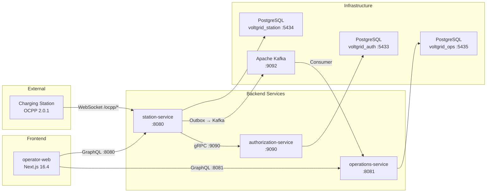

# 03 — Architecture Review

> **Audit**: VG-200 · **Commit**: `e6bf891` · **Date**: 2026-11-26

## Current architecture

## Strengths

1. **Clean domain separation**: Each service owns its bounded context (stations/OCPP, authorization, operations projections).
2. **Transactional outbox pattern**: Station-service uses an outbox table with Kafka relay, providing at-least-once event delivery with atomicity.
3. **Idempotent consumer**: Operations-service uses `processed_event_receipts` for deduplication.
4. **Hexagonal architecture**: Application/domain/infrastructure layers are well separated in station-service.
5. **Comprehensive OCPP 2.0.1 frame handling**: 5 operations implemented with proper CALL/CALLRESULT/CALLERROR framing.
6. **Graceful shutdown**: `ApplicationShutdownState` prevents false OFFLINE marking during server restart.
7. **Frontend design system**: Orchid & Clay system with accessible primitives, 168 passing unit tests.

## Weaknesses

1. **No authentication/authorization layer**: Zero Spring Security across all services. No OIDC, no JWT, no RBAC.
2. **No service-to-service auth**: gRPC channel from station-service to authorization-service is plaintext with no mutual auth.
3. **Single-instance assumptions**: WebSocket handler, outbox relay, and liveness monitor have race conditions under multi-instance deployment.
4. **No API gateway**: Frontend connects directly to two backend services on different ports.
5. **Monolithic deployment coupling**: Three services share one Docker Compose with hard-coded hostnames, no service mesh.
6. **No schema registry**: Kafka events use raw JSON strings with no schema evolution protection.
7. **Unbounded query surfaces**: Most GraphQL queries return full table contents with no pagination.

## Architectural recommendations

| Priority | Recommendation | Milestone |
|---|---|---|
| P0 | Add Spring Security resource server with JWT/OIDC to all services | VG-202 |
| P0 | Add OCPP station authentication (Basic Auth minimum) | VG-202 |
| P1 | Enable TLS on all transport channels | VG-203 |
| P1 | Add API gateway or BFF layer for frontend | VG-203 |
| P1 | Fix multi-instance race conditions in outbox relay and WS handler | VG-204 |
| P2 | Add pagination to all GraphQL list queries | VG-205 |
| P2 | Introduce Kafka schema registry (Avro/Protobuf) | VG-205 |
| P3 | Add service mesh or mTLS for inter-service communication | VG-207 |
