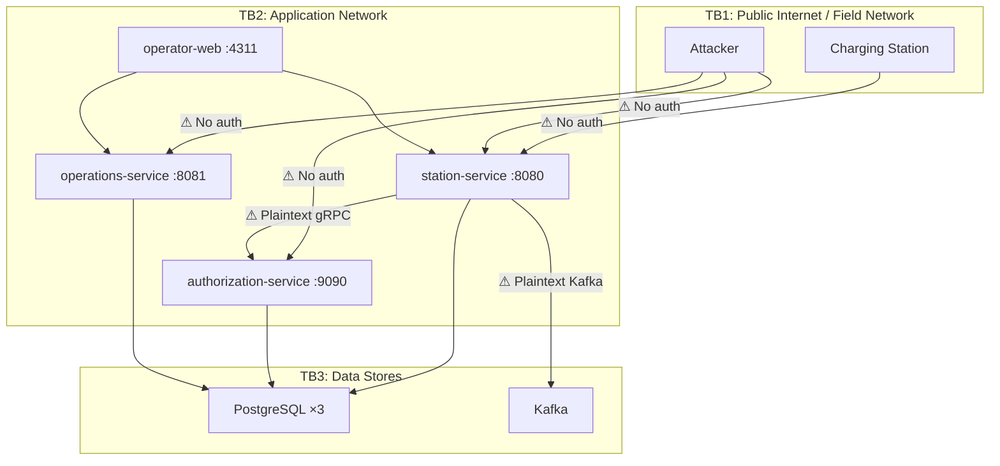

# 04 — Threat Model

> **Audit**: VG-200 · **Commit**: `e6bf891` · **Date**: 2026-11-26

## Assets

| ID | Asset | Sensitivity |
|---|---|---|
| A1 | Charging station identity and connectivity | High — station impersonation enables energy theft |
| A2 | Charging transactions and meter data | High — billing evidence |
| A3 | Authorization tokens (RFID/idTags) | High — PII, access credentials |
| A4 | Operator dashboard and management API | Medium — station registration, network visibility |
| A5 | Infrastructure credentials (DB passwords, HMAC keys) | Critical — full system compromise |
| A6 | Service availability | High — charging interruption |

## Actors

| Actor | Trust level | Entry points |
|---|---|---|
| Charging station (OCPP client) | Low — field-deployed hardware | WebSocket `/ocpp/*` on port 8080 |
| Operator (human user) | Medium — authenticated operator | Browser → Next.js → GraphQL 8080/8081 |
| Internal service | High — backend-to-backend | gRPC 9090, Kafka 9092 |
| External attacker | None | Any network-accessible port |

## Trust boundaries

## STRIDE Analysis

### Spoofing

| Threat | Finding | Severity |
|---|---|---|
| Station identity spoofing via URL path | SEC-001 | Critical |
| Operator identity spoofing (no OIDC/JWT) | SEC-002 | Critical |
| Service-to-service spoofing (no mTLS) | SEC-004 | High |

### Tampering

| Threat | Finding | Severity |
|---|---|---|
| Arbitrary station registration via GraphQL | SEC-002 | Critical |
| Transaction data manipulation via crafted OCPP events | SEC-001 + BUG-008 | High |
| HMAC key override with hardcoded fallback | SEC-003 | High |
| Connector status overwrite without timestamp check | BUG-008 | Moderate |

### Repudiation

| Threat | Finding | Severity |
|---|---|---|
| No audit trail for operator mutations | GAP-001 | Moderate |
| No authentication identity in access logs | SEC-002 | Critical |

### Information Disclosure

| Threat | Finding | Severity |
|---|---|---|
| Plaintext transport exposes all data in transit | SEC-004 | High |
| GraphQL introspection exposes full schema | BUG-005 | High |
| Database credentials in `application.properties` defaults | SEC-003 | Moderate |
| Actuator health endpoint exposed | INF-001 | Low |

### Denial of Service

| Threat | Finding | Severity |
|---|---|---|
| Integer overflow infinite loop in completeness | BUG-001 | Critical |
| Unbounded GraphQL queries exhaust DB/memory | BUG-005 | High |
| Outbox poison pill blocks all event relay | BUG-004 | High |
| WebSocket disconnect race creates phantom sessions | BUG-003 | High |

### Elevation of Privilege

| Threat | Finding | Severity |
|---|---|---|
| Any network client has full admin access | SEC-002 | Critical |
| No RBAC — all operators have identical privileges | GAP-002 | Moderate |
