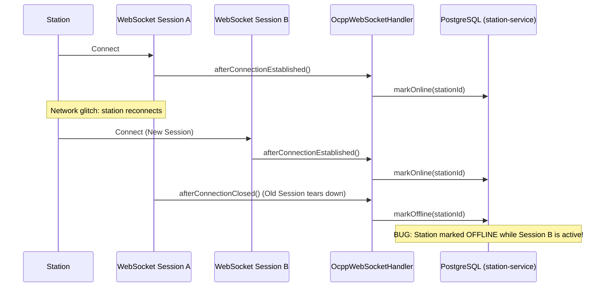

# 08 — Distributed System Reliability

> **Audit**: VG-200 · **Commit**: `e6bf891` · **Date**: 2026-11-26

## Overview

VoltGrid relies on an event-driven distributed architecture comprising:
1. **OCPP 2.0.1 WebSocket ingress** (`station-service`)
2. **Transactional Outbox & Relay** (`station-service` PostgreSQL → Apache Kafka)
3. **Synchronous gRPC communication** (`station-service` → `authorization-service`)
4. **Idempotent event projection** (Kafka consumer → `operations-service` PostgreSQL)

This audit analyzed the concurrency, fault-tolerance, and consistency guarantees across all distributed boundaries.

---

## 1. WebSocket Session Ownership & Reconnection Concurrency (BUG-003)

### Analysis
- **Code**: `services/station-service/src/main/java/com/voltgrid/station/api/ocpp/OcppWebSocketHandler.java` (L69–L84)
- When a physical EV charging station experiences network flakiness, it initiates a new WebSocket connection before the old TCP session has timed out or closed cleanly.
- `afterConnectionClosed` blindly extracts the `stationId` from the closing session's attributes and invokes:
  ```java
  connectivityService.markOffline(stationId);
  ```
- **Flaw**: There is no session tracking or session ID verification. If Session B (new) connects at $t_1$, and Session A (stale) closes at $t_2$ ($t_2 > t_1$), Session A's closure triggers `markOffline`, setting the station status to `OFFLINE` and generating a spurious `StationStatusChangedEvent` despite Session B being active and healthy.

### Concurrency Race Diagram


---

## 2. Transactional Outbox Pattern & Poison-Pill Resilience (BUG-004, BUG-006)

### Outbox Implementation
- **Files**:
  - `services/station-service/src/main/java/com/voltgrid/station/messaging/outbox/OutboxRelayService.java`
  - `services/station-service/src/main/java/com/voltgrid/station/messaging/outbox/OutboxRelayScheduler.java`
  - `services/station-service/src/main/java/com/voltgrid/station/messaging/outbox/OutboxEventRepository.java`
  - `services/station-service/src/main/resources/db/migration/V9__create_outbox_events.sql`

### Finding 1: Head-of-Line Blocking / Poison Pill (BUG-004)
The outbox query claims events ordered by `created_at ASC`:
```java
List<OutboxEventEntity> events = outboxEventRepository.claimNextBatch(batchSize);
```
- The relay processes events sequentially. If Kafka is unreachable or a message fails serialization/sending:
  ```java
  kafkaTemplate.send(topic, event.getAggregateId(), event.getPayload()).get(publishTimeoutSeconds, TimeUnit.SECONDS);
  ```
- Upon failure, an exception is logged, the transaction rolls back, and the event remains in `PENDING` state.
- **Vulnerability**: There is no `retry_count`, no exponential backoff, and no dead-letter queue (DLQ) for failed outbox events. A single poisoned row or unroutable topic blocks all subsequent outbox publishing indefinitely.

### Finding 2: Out-of-Order Delivery under Multi-Instance Relay (BUG-006)
- The claim query uses:
  ```sql
  SELECT * FROM outbox_events WHERE status = 'PENDING' ORDER BY created_at ASC LIMIT :batchSize FOR UPDATE SKIP LOCKED
  ```
- If `station-service` is scaled horizontally to 2+ replicas with `OUTBOX_RELAY_ENABLED=true`:
  - Instance 1 claims Event 1 (Station X: `ONLINE` at 10:00:00.100).
  - Instance 2 claims Event 2 (Station X: `OFFLINE` at 10:00:00.200).
  - If Instance 1 experiences a minor GC pause or network stall, Instance 2 delivers Event 2 to Kafka before Instance 1 delivers Event 1.
  - Result: Kafka receives `OFFLINE` followed by `ONLINE`, inverting the true chronological sequence.

---

## 3. Liveness Monitor Outbox Event Omission (BUG-002)

### Analysis
- **Code**: `services/station-service/src/main/java/com/voltgrid/station/application/StationLivenessService.java`
- Scheduled job `StationLivenessMonitor` periodically runs every 1 minute:
  ```java
  stationLivenessService.markStaleStationsOffline(threshold);
  ```
- Inside `StationLivenessService`:
  ```java
  for (ChargingStation station : staleStations) {
      stationWriter.save(new ChargingStation(station.id(), station.name(), StationStatus.OFFLINE, station.lastSeenAt()));
  }
  ```
- **Flaw**: `StationLivenessService` directly writes to `stationWriter` but **fails to call `StationStatusOutboxWriter`**.
- **Impact**: The database marks the station `OFFLINE`, but no event is placed into `outbox_events`. Consequently, `operations-service` and the operator dashboard projection never receive an update and continue reporting the station as `ONLINE`.

---

## 4. Projection Monotonicity & Timestamp Collision (BUG-010)

### Analysis
- **Code**: `services/operations-service/src/main/java/com/voltgrid/operations/infrastructure/persistence/StationStatusProjectionEntity.java`
- In `apply(StationStatusChangedEvent event)`:
  ```java
  if (!event.occurredAt().isAfter(this.statusChangedAt)) {
      LOGGER.warn("Ignoring stale or duplicate status event: {}", event);
      return;
  }
  ```
- **Flaw**: If two events for the same station occur within the exact same millisecond or possess identical timestamps (e.g. system clock resolution on containerized environments):
  - `event.occurredAt().isAfter(this.statusChangedAt)` evaluates to `false`.
  - The second event is silently discarded as "stale or duplicate".
- **Impact**: Status transitions occurring within the same millisecond are dropped, potentially leaving the projection out of sync with actual hardware state.

---

## 5. Consumer Deduplication & Storage Leak

### Analysis
- **Code**: `services/operations-service/src/main/java/com/voltgrid/operations/infrastructure/persistence/ProcessedEventReceiptEntity.java`
- Consumer idempotence is implemented via `processed_event_receipts` table:
  ```sql
  CREATE TABLE processed_event_receipts (
      event_id VARCHAR(64) PRIMARY KEY,
      processed_at TIMESTAMP WITH TIME ZONE NOT NULL
  );
  ```
- **Evaluation**: Deduplication logic is sound and correctly prevents duplicate Kafka messages from corrupting projection state.
- **Limitation**: There is no TTL, partitioning, or cleanup job for `processed_event_receipts` or `outbox_events` (station-service). Over months of operation with high-frequency telemetry, these tables will grow monotonically, degrading query latency.

---

## Summary of Distributed Systems Findings

| ID | Title | Severity | Component | Milestone |
|---|---|---|---|---|
| **BUG-002** | Liveness monitor skips outbox event generation | Critical | station-service | VG-201 |
| **BUG-003** | WebSocket disconnect race condition in session teardown | High | station-service | VG-201 |
| **BUG-004** | Outbox relay head-of-line blocking (poison pill) | High | station-service | VG-204 |
| **BUG-006** | `SKIP LOCKED` outbox relay aggregate ordering violation | High | station-service | VG-204 |
| **BUG-010** | Equal-timestamp events dropped in operations projection | Moderate | operations-service | VG-204 |
| **DATA-003**| Unbounded monotonic growth of event tables (no retention) | Moderate | station/operations | VG-205 |
