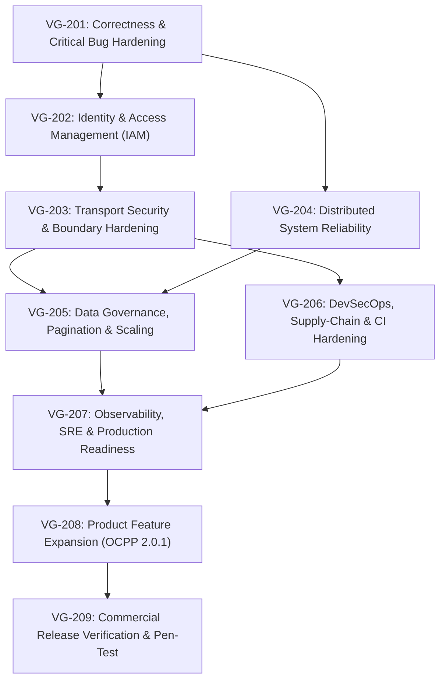

# 16 — Implementation Roadmap

> **Audit**: VG-200 · **Commit**: `e6bf891` · **Date**: 2026-11-26

## Overview

To transition VoltGrid from an unauthenticated development prototype into an enterprise-grade, secure, reliable, and commercially viable EV charging network platform, this roadmap establishes a phased sequence of 9 milestones (**VG-201 through VG-209**).

---

## Milestone VG-201: Immediate Correctness and Critical Bug Hardening

- **Objective**: Eliminate critical crash bugs, infinite loops, and data synchronization divergence.
- **Findings Addressed**: BUG-001, BUG-002, BUG-003, BUG-008, BUG-011.
- **Prerequisites**: None.
- **Key Tasks**:
  1. Add integer bounds validation on `TransactionEventRequest.seqNo` (max 1,000,000) in `OcppMessageProcessor`.
  2. Fix infinite loop in `TransactionCompletenessService.findMissingSequenceNumbers` with upper-bound guards.
  3. Inject `StationStatusOutboxWriter` into `StationLivenessService.markStaleStationsOffline` to generate outbox events on stale disconnects.
  4. Implement session ownership tracking in `OcppWebSocketHandler` using a thread-safe session map to prevent reconnection disconnect races.
  5. Add timestamp monotonicity check in `StationConnectorStatusService.updateStatus`.
  6. Add `@Transactional` to `StationRegistrationService.register`.
- **Effort Estimate**: 2–3 engineering days.

---

## Milestone VG-202: Identity and Access Management (IAM)

- **Objective**: Establish robust authentication and authorization across all API surfaces and OCPP connections.
- **Findings Addressed**: SEC-001, SEC-002, SEC-003.
- **Prerequisites**: VG-201.
- **Key Tasks**:
  1. **OCPP Station Authentication**:
     - Implement HTTP Basic Authentication and Pre-Shared Token validation in `OcppHandshakeInterceptor`.
     - Create `station_credentials` table with bcrypt-hashed passwords.
  2. **Operator API Security**:
     - Introduce `spring-boot-starter-security` and `spring-boot-starter-oauth2-resource-server` across all three services.
     - Configure JWT token validation with OpenID Connect (OIDC) provider (Keycloak / AWS Cognito / Auth0).
     - Protect GraphQL endpoints and mutations with `@PreAuthorize("hasRole('OPERATOR')")`.
  3. **HMAC Key Management**:
     - Remove hardcoded HMAC fallback key in `TokenFingerprintService`. Require high-entropy key injection on startup.
- **Effort Estimate**: 5–7 engineering days.

---

## Milestone VG-203: Transport Security and Network Boundary Hardening

- **Objective**: Ensure 100% encrypted in-transit communication and isolate internal services.
- **Findings Addressed**: SEC-004, SEC-005, SEC-006.
- **Prerequisites**: VG-202.
- **Key Tasks**:
  1. **TLS / WSS Enforcement**:
     - Upgrade ALB to terminate HTTPS on port 443 with ACM certificate.
     - Configure `wss://` secure WebSocket for OCPP connections.
     - Enable gRPC TLS between `station-service` and `authorization-service`.
     - Enable Kafka `SSL` / `SASL_SSL` transport encryption.
     - Add `sslmode=require` to all PostgreSQL JDBC connection strings.
  2. **Terraform Network Isolation**:
     - Relocate `authorization-service`, `operations-service`, and RDS instances into private subnets.
     - Restrict security group ingress/egress to strictly necessary internal communication paths.
  3. **Docker Compose Hardening**:
     - Bind all developer Compose ports explicitly to `127.0.0.1`.
- **Effort Estimate**: 3–5 engineering days.

---

## Milestone VG-204: Distributed System Reliability and Fault Tolerance

- **Objective**: Prevent head-of-line blocking, ensure event ordering, and guarantee projection consistency.
- **Findings Addressed**: BUG-004, BUG-006, BUG-010.
- **Prerequisites**: VG-201.
- **Key Tasks**:
  1. **Outbox Poison-Pill Resilience**:
     - Add `retry_count`, `last_attempted_at`, and `error_message` to `outbox_events`.
     - Implement dead-letter table `outbox_dead_letters` for events failing after 5 retries.
  2. **Aggregate-Partitioned Outbox Relay**:
     - Enforce partition keying in Kafka by station ID to guarantee in-order delivery per charger.
  3. **Equal-Timestamp Resolution in Projections**:
     - Modify `StationStatusProjectionEntity` to use non-strict monotonicity (`!isBefore`) with event ID tie-breaking.
- **Effort Estimate**: 4–5 engineering days.

---

## Milestone VG-205: Data Governance, Pagination and Database Scaling

- **Objective**: Protect database resources, enforce pagination on all queries, and manage data lifecycles.
- **Findings Addressed**: BUG-005, DATA-001, DATA-002, DATA-003, DATA-004.
- **Prerequisites**: VG-204.
- **Key Tasks**:
  1. Add cursor/offset pagination to `stations`, `transactions`, and `transactionMeterSamples` GraphQL queries.
  2. Harmonize `charging_stations.id` and `outbox_events.aggregate_id` column widths (standardize on VARCHAR(255)).
  3. Optimize V11 transaction integrity view to cap `generate_series` sequences.
  4. Create composite index on `transaction_meter_samples(station_id, transaction_id, sequence_number)`.
  5. Add `@Version` optimistic locking to all domain entities.
  6. Implement data retention purge jobs for processed receipts and historical samples.
- **Effort Estimate**: 4–6 engineering days.

---

## Milestone VG-206: DevSecOps, Supply-Chain and CI Hardening

- **Objective**: Automate security testing and eliminate supply-chain vulnerabilities in CI/CD pipelines.
- **Findings Addressed**: INF-003, INF-004, INF-005.
- **Prerequisites**: VG-203.
- **Key Tasks**:
  1. Pin all GitHub Actions to full 40-character commit SHAs.
  2. Add automated SAST scanning (CodeQL) to all pull requests.
  3. Integrate dependency scanning (Trivy / OWASP Dependency-Check) into CI pipelines.
  4. Add container image scanning and SBOM generation (Syft/Grype).
  5. Add Gitleaks secret scanning step to all pull request workflows.
- **Effort Estimate**: 2–3 engineering days.

---

## Milestone VG-207: Observability, SRE and Operational Readiness

- **Objective**: Provide enterprise operational visibility, unified tracing, and actionable alerting.
- **Findings Addressed**: OBS-001, OBS-002, OBS-003.
- **Prerequisites**: VG-205, VG-206.
- **Key Tasks**:
  1. Package OpenTelemetry Java Agent into container images for all three services.
  2. Implement Prometheus metrics starter across all services, including `authorization-service`.
  3. Export custom business metrics (OCPP message rate, outbox lag, authorization latency).
  4. Define Prometheus alerting rules and Grafana dashboards for SLO tracking.
- **Effort Estimate**: 3–4 engineering days.

---

## Milestone VG-208: Product Feature Expansion (OCPP 2.0.1 Core)

- **Objective**: Deliver essential CSMS operator capabilities.
- **Findings Addressed**: GAP-001, GAP-002, GAP-003.
- **Prerequisites**: VG-207.
- **Key Tasks**:
  1. Implement CSMS outbound CALL mechanism for Remote Start, Remote Stop, and Connector Unlock.
  2. Support standalone `MeterValues` message ingestion.
  3. Build operator UI for RFID token management and issuance.
  4. Support RFC 3339 timezone offset parsing for charging station clocks.
- **Effort Estimate**: 8–10 engineering days.

---

## Milestone VG-209: Commercial Release Verification and Pen-Testing

- **Objective**: Final certification, penetration testing, and human usability sign-off.
- **Prerequisites**: All previous milestones.
- **Key Tasks**:
  1. Conduct third-party application penetration testing across WebSocket, GraphQL, and gRPC.
  2. Perform load and stress testing up to 5,000 simulated concurrent charging stations.
  3. Complete human usability validation gates (G1, G3, G7, G8).
  4. Issue production release certification.
- **Effort Estimate**: 5–7 engineering days.
