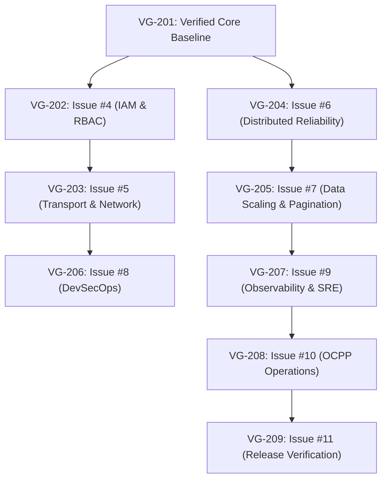

# 08 — Remaining Risks and Follow-Up Register

> **Milestone**: VG-201
> **Status**: Reconciled Backlog
> **Date**: 2026-11-26

---

## 1. Traceability to Commercial Engineering Milestones

Every defect and architectural nuance identified during VG-201 verification has been verified as non-blocking for milestone completion and mapped directly to existing commercial engineering issues.

---

## 2. Reconciled Risk and Defect Register

### 1. Sequence Truncation Defaulting to COMPLETE
- **Source**: BUG-001 boundary condition in `TransactionCompletenessService`.
- **Description**: When `(long) lastSequenceNumber - firstSequenceNumber > 100_000`, `findMissingSequenceNumbers` returns an empty list (`List.of()`). `determineStatus` interprets `missingSequenceNumbers.isEmpty()` as `TransactionDataStatus.COMPLETE`. An ended transaction with missing events spanning > 100,000 sequence numbers is reported as COMPLETE.
- **Impact**: Incorrect completeness calculation for rare abnormally sparse sessions.
- **Remediation**: Introduce a distinct status `TransactionDataStatus.UNBOUNDED_SEQUENCE_GAP` or pagination on missing sequence intervals.
- **Target Milestone**: **VG-205** ([#7](https://github.com/Suthankan1/voltgrid/issues/7)).

---

### 2. Process-Local WebSocket Connection Registry
- **Source**: BUG-003 multi-instance limitation in `OcppWebSocketHandler`.
- **Description**: `activeStationSessions` is a process-local `ConcurrentHashMap`. If the CSMS backend is scaled to multiple container replicas behind a load balancer, an older connection closing on Replica 1 will not recognize that a newer connection was established on Replica 2, prematurely marking the station offline.
- **Impact**: Status flickering during charger reconnects in clustered deployments.
- **Remediation**: Implement a shared Redis or database-backed session registry with generation fencing tokens.
- **Target Milestone**: **VG-204** ([#6](https://github.com/Suthankan1/voltgrid/issues/6)).

---

### 3. Equal-Timestamp Causal Ordering Non-Determinism
- **Source**: BUG-010 tie-breaking limitation in `StationStatusProjectionEntity`.
- **Description**: Events occurring in the same millisecond are now accepted rather than dropped, but the final projection state is sensitive to the order in which Kafka delivers the events (last-write-wins). Reversing delivery order flips the final state.
- **Impact**: Inverted projection status if an ONLINE and OFFLINE event share the same millisecond and arrive out of order during consumer replay.
- **Remediation**: Add a monotonic aggregate version or sequence counter to `StationStatusChangedEvent` and enforce `event.version() > this.version` in the projection.
- **Target Milestone**: **VG-204** ([#6](https://github.com/Suthankan1/voltgrid/issues/6)).

---

### 4. Cross-Service Station Identifier Width Inconsistency
- **Source**: DATA-001 schema mismatch between station-service and operations-service.
- **Description**: While `outbox_events.aggregate_id` was widened to `VARCHAR(255)` via Flyway V12, `station_status_projections.station_id` in `operations-service` remains `VARCHAR(128)`.
- **Impact**: Stations with IDs between 129 and 255 characters register cleanly in station-service, but throw database constraint violations when operations-service attempts to project their status.
- **Remediation**: Add a Flyway migration in `operations-service` to widen `station_status_projections.station_id` to `VARCHAR(255)`.
- **Target Milestone**: **VG-205** ([#7](https://github.com/Suthankan1/voltgrid/issues/7)).

---

### 5. Observability Port Wildcard Exposure
- **Source**: SEC-006 binding limitation in `observability/local/compose.yaml`.
- **Description**: Jaeger (16686), OTel Collector (4317, 4318), and Prometheus (9091) publish ports to `0.0.0.0` rather than `127.0.0.1`.
- **Impact**: Observability interfaces accessible across local physical networks.
- **Remediation**: Add `127.0.0.1:` host prefix to all port mappings in `observability/local/compose.yaml`.
- **Target Milestone**: **VG-203** ([#5](https://github.com/Suthankan1/voltgrid/issues/5)).

---

### 6. Missing Optimistic Locking Across JPA Entities
- **Source**: DATA-004 in JPA entity definitions.
- **Description**: Entities (`ChargingStationEntity`, `StationConnectorEntity`, `ChargingTransactionEntity`, `AuthorizationTokenEntity`, `StationStatusProjectionEntity`) lack `@Version` optimistic locking fields.
- **Impact**: Concurrent database writes from parallel transactions (such as concurrent status updates on multi-connector chargers) are subject to lost updates.
- **Remediation**: Add `@Version private Long version;` to all domain entities.
- **Target Milestone**: **VG-205** ([#7](https://github.com/Suthankan1/voltgrid/issues/7)).

---

### 7. Playwright Headless Firefox Environment Limitation
- **Source**: Local macOS arm64 environment issue.
- **Description**: Playwright's cached Firefox Nightly runner fails to initialize profile directories in `/var/folders/` in headless mode on macOS arm64. Chromium and WebKit pass 100%. Linux CI runs pass 100%.
- **Impact**: Local cross-browser execution on macOS requires Chromium or WebKit.
- **Remediation**: Run cross-browser suite in Linux Docker container or rely on GitHub Actions Ubuntu runner.
- **Target Milestone**: Operational environment documentation.
