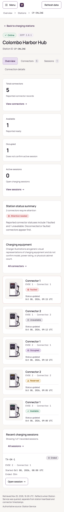
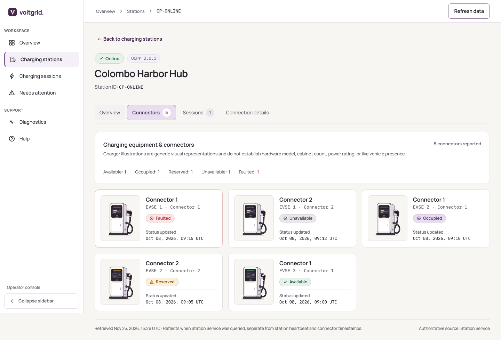

# VoltGrid Experience Redesign — Release Evidence Index (UI-110 / UI-110K)

- **Development branch**: `redesign/operator-experience` (Draft PR `#1`: https://github.com/Suthankan1/voltgrid/pull/1)
- **Target branch**: `main` (baseline merge-base `f4708fb558226d8dfc43bcb2893b39f33782bab4`)
- **Final verified runtime commit**: `345aa6d` (`chore(operator): upgrade next to 16.4.6 and resolve security advisories`)
- **Backend/Infrastructure preservation**: Zero modifications to `services/`, `compose*.yaml`, `infrastructure/`, or runtime backend/database contracts.
- **Documentation Note (UI-109 Terminology Correction)**: An earlier UI-109 engineering note inaccurately described offline stations on `/attention` as Operations projection data. Verified code in `apps/operator-web/src/app/attention/page.tsx` and `apps/operator-web/src/lib/attention-model.ts` uses `getStationSnapshot()` from authoritative **Station Service** for offline stations and `networkTransactionPage(integrityStatus: INCOMPLETE)` for incomplete sessions.

## 1. Curated Visual Evidence (Mandatory Charger Illustration Review — Pending Owner Sign-Off)

Independent inspection of desktop, mobile, and close-up screenshots confirmed the charger artwork matches the approved simple, realistic generic light-industrial direction. **Current design preserved**; **mobile metric-card density** (4 stacked KPI cards preceding station status summary on narrow viewports) is recorded as a **candidate item for human usability observation (`G7`)**, not an unapproved redesign task. Formal owner visual sign-off (`G1`) remains pending.

| Artifact | Purpose | Screenshot |
|---|---|---|
| Station Overview Desktop (`1440×900`) | KPI cards, status summary, sorted connector cards (`Faulted` first), recent sessions |  |
| Station Overview Mobile (`390×844`) | Single-column stacking, tabs, simple charger cards |  |
| Close-up Charger Card | Generic pedestal cabinet, dark fascia, semantic light bar, abstract screen, docked plug |  |
| All 5 Connector Statuses | `Faulted`, `Unavailable`, `Occupied`, `Reserved`, `Available` |  |
| Offline Station & Guidance | Offline warning banner and *"Last reported status — station currently offline"* labels |  |

## 2. Engineering Verification Matrix (Verified at Runtime Commit `345aa6d`)

- **Frozen dependency install** (`pnpm --dir apps/operator-web install --frozen-lockfile`): Passed.
- **Unit/component tests** (`pnpm --dir apps/operator-web test`): **168 passed**, 0 failed, 0 skipped.
- **Lint & TypeScript**: `pnpm lint` passed (0 errors); `pnpm exec tsc --noEmit` passed (0 errors).
- **Production build** (`pnpm --dir apps/operator-web build`): Next.js `16.4.6` (`--webpack`, `14` app routes) passed cleanly without build-time network downloads (`.next/static` = `1.2M`, CSS = `40K`).
- **Fixture Playwright Chromium Suite** (`pnpm --dir apps/operator-web test:e2e`): **36 passed** (`1.7m` local macOS; **2.1m** Linux CI `45756851981`) across all specs (`a11y.spec.ts`, `attention-diagnostics-help.spec.ts`, `cross-browser.spec.ts`, `integrated-journeys.spec.ts`, `operator.spec.ts`, `overview.spec.ts`, `sessions.spec.ts`, `sessions-directory.spec.ts`, `shell.spec.ts`, `station-detail.spec.ts`, `station-registration.spec.ts`, `stations.spec.ts`, `ui-primitives.spec.ts`).
- **Automated Accessibility** (`pnpm --dir apps/operator-web test:a11y`): `@axe-core/playwright` `4.14.1` (`wcag2a`, `wcag2aa`, `wcag21a`, `wcag21aa`, `wcag22aa`), **1 passed (`14.4s` local / `22.5s` CI `45756851981`)** — **0 violations** across 35+ rendered screens, dialogs, empty/clear states, and partial/unavailable error states, plus `320×568` overflow and `44×44px` control target assertions.
- **Cross-Browser & Responsive Matrix** (`pnpm --dir apps/operator-web test:e2e:cross-browser` across `320×568`, `390×844`, `430×932`, `768×1024`, `1024×768`, `1280×800`, `1440×900`, `1920×1080`):
  - **Linux GitHub Actions CI (`ubuntu-latest`, run `45756851981`, `345aa6d`)**: **54 / 54 passed (`4.0m`)** — Chromium (`18 / 18`), Firefox (`18 / 18`), and WebKit (`18 / 18`).
  - **Local macOS host**: Chromium (`18 / 18`) and WebKit (`18 / 18`) passed (`36 passed, 2.1m`); local Playwright Firefox (`firefox-1543`) remains blocked in the sandboxed macOS agent environment (`Nightly.app`: `Could not find profile folder.`).
  - **Real Desktop Browsers**: Google Chrome (`158.0.8127.37`) and Safari are installed on macOS (`Firefox.app` and `Microsoft Edge.app` not installed); manual real-browser walkthroughs remain **Pending human execution** (Playwright WebKit is not treated as manual Safari).
- **Isolated Real-Stack Compose Verification** (`voltgrid-ui110k-test`, `pnpm --dir apps/operator-web test:e2e:live` at `345aa6d`): **1 passed (`10.7s`)** across full OCPP WebSocket -> Station Service -> Authorization gRPC -> transactional outbox -> Kafka -> Operations Service -> PostgreSQL projections -> Console UI, followed by full `docker compose ... down -v --remove-orphans` teardown.
- **UI-110K CI Blocker Resolutions**:
  1. `703bc45`: Fixed `200%` font-size CSS Grid / inline-`<code>` overflow in `Card` (`min-w-0`), `CardTitle` / `CardDescription` (`min-w-0 break-words`), `HelpView`, `MetricCard` (`text-[min(2rem,11vw)]`), `AttentionSessionsSection` / `AttentionStationsSection` (`max-w-full flex-wrap`), `PageHeader`, and `ConnectorCard` (`min-w-[min(9.5rem,100%)]`), waited for Server Action `<head>` reconciliation settle in `e2e/a11y.spec.ts` (`expect(page).toHaveTitle("VoltGrid Operator Console")`), and restricted WebKit `cross-browser.spec.ts` prefetch filter strictly to `webkit` project same-origin `[?&]_rsc=` unload aborts.
  2. `9415b6e`: Isolated `e2e/graphql-fixture.mjs` via `POST /__reset` in `operator.spec.ts` & `cross-browser.spec.ts` `test.beforeEach` hooks so offline registrations never accumulate across browser projects and push `Colombo Central` out of Overview's 6-station preview.

## 3. Dependency Security Audit & Advisory Dispositions

Following upgrades on `345aa6d` (`next` `16.3.5` -> `16.4.6`, `eslint-config-next` `16.3.5` -> `16.4.6`, `sharp` `0.35.4` -> `0.35.5`, `source-map-js` `1.2.1` -> `1.2.4`, `zod` `4.6.5` -> `4.6.7`):
- `pnpm --dir apps/operator-web audit --prod`: **0 critical, 0 high, 0 moderate, 0 low**.
- `pnpm --dir apps/operator-web audit`: **0 critical, 0 high, 1 moderate (dev-only `minimatch@10.2.6` via `eslint-config-next > @typescript-eslint/typescript-estree`), 0 low**.

| Advisory | Severity | Affected Pkg (`16.3.5` baseline) | Scope & Path | Prerequisites & VoltGrid Applicability | Disposition & Verification |
|---|---|---|---|---|---|
| `GHSA-p3m5-59mp-jv5r` (`CVE-2026-94482`) | High | `next@16.3.5` (`<=16.4.0`) | Prod (`.>next`) | App Router app with `>=1` `"use server"` Server Action. **Applicable** (`registerStationAction`, `verifyStationRegistrationAction` in `src/app/stations/new/actions.ts`). | **Remediated** (`next@16.4.6`, `>=16.4.1`). Cleared in `audit` & `audit --prod`. |
| `GHSA-vcvr-r3jv-pc5j` | Critical | `next@16.3.5` (`<16.3.6`) | Prod (`.>next`) | Node `next/og` `ImageResponse` with untrusted SVG input. `next/og` unused in VoltGrid. | **Remediated** (`next@16.4.6`). Cleared in `audit` & `audit --prod`. |
| `GHSA-2464-fhr4-w9xw` | Critical | `next@16.3.5` (`<=16.4.0`) | Prod (`.>next`) | Next Image Optimization API SVG processing on glibc Linux (`sharp < 0.35.5`). `next/image` unused. | **Remediated** (`next@16.4.6`, `sharp@0.35.5`). Cleared in `audit` & `audit --prod`. |
| `GHSA-673q-mjm6-r5xr` | Critical | `next@16.3.5` (`<=16.4.0`) | Prod (`.>next`) | App Router `"use cache"` returning typed arrays. `use cache` unused in VoltGrid (`force-dynamic`). | **Remediated** (`next@16.4.6`). Cleared in `audit` & `audit --prod`. |
| `GHSA-cjq9-62q9-8jv4` (`CVE-2026-94483`) | High | `next@16.3.5` (`<16.3.8`) | Prod (`.>next`) | Allow-listed `images.remotePatterns` in Image Optimization. No `remotePatterns` configured. | **Remediated** (`next@16.4.6`). Cleared in `audit` & `audit --prod`. |
| `GHSA-wq5f-xc86-pv6w` | High | `sharp@0.35.4` (`<0.35.5`, opt.) | Prod (`.>next>sharp`) | `librsvg` CVE-2026-96889 SVG decode in `sharp`. Image Optimization unused. | **Remediated** (`sharp@0.35.5`). Cleared in `audit` & `audit --prod`. |
| `GHSA-68fv-2mgg-jv7q` (`CVE-2026-93749`) | High | `source-map-js@1.2.1` (`<1.2.2`) | Prod (`.>next>postcss`, `@tailwindcss/postcss`) | Malicious indexed source map offsets during PostCSS build. Static checked-in CSS only. | **Remediated** (`source-map-js@1.2.4`). Cleared in `audit` & `audit --prod`. |
| `GHSA-mrhx-c7xc-m3w5` (`CVE-2023-54404`) | High | `zod@4.6.5` (`<4.6.6`) | Dev (`eslint-config-next > eslint-plugin-react-hooks > zod`) | Unbounded Zod array parsing in ESLint dev plugin. | **Remediated** (`zod@4.6.7`). Cleared in `audit`. |

## 4. Production Build Performance Assessment (Commit `345aa6d`)

### Reproducible Lighthouse `13.6.0` Audit (3 Repeated Runs / Route)

- **Hardware / Browser / Network**: Apple M4 (`10` cores, `16 GB` RAM), `darwin 27.2.0` (`macOS 27.2.1`), Google Chrome `158.0.8127.37`, `lighthouse 13.6.0`, headless Next.js `16.4.6` production server (`next start`) on loopback `127.0.0.1` against deterministic fixture (**50 stations** — 30 online / 20 offline, **6 connectors** on `CP-01`, **25 transactions**, **1,000 meter samples**, **10,000 sequence span**).
- **Throttling presets**:
  - `--preset=desktop`: `1350×940`, simulated 10.24 Mbps down / 40 ms RTT, 1x CPU.
  - Default mobile preset: `412×823`, simulated Slow 4G (1.6 Mbps / 150 ms RTT), 4x CPU slowdown.
- **Comparison against `docs/redesign/acceptance-criteria.md`**: Targets are Lighthouse Performance `>= 90`, Lighthouse Accessibility `100`, LCP `<= 2500 ms`, CLS `<= 0.1`. All measured routes meet every lab target:

| Route & Preset | Median Perf | Median A11y | Median LCP (Range) | Max CLS | Median TBT |
|---|---:|---:|---:|---:|---:|
| `desktop /` | **100** | **100** | **612 ms** (`612–619 ms`) | **0** | **0 ms** |
| `mobile /` | **99** | **100** | **2256 ms** (`2255–2256 ms`) | **0** | **9 ms** (`7–10 ms`) |
| `desktop /stations` | **100** | **100** | **612 ms** (`608–613 ms`) | **0** | **0 ms** |
| `desktop /stations/CP-01` | **100** | **100** | **171 ms** (`170–171 ms`) | **0.0001** | **0 ms** |
| `desktop /stations/CP-01/sessions/TX-1?section=measurements` | **100** | **100** | **169 ms** (`168–169 ms`) | **0** | **0 ms** |
| `desktop /diagnostics` | **100** | **100** | **651 ms** (`650–652 ms`) | **0** | **0 ms** |
| `desktop /help` | **100** | **100** | **204 ms** (`204–205 ms`) | **0.0035** | **0 ms** |

### Historical Local Chromium Lab Measurements (Pre-Upgrade `Next 16.3.5` Baseline, Retained for Continuity)

- Unthrottled Chromium `153.0.8010.12` (3 cold runs across 9 routes on same fixture): TTFB `2.1–71.3 ms`, FCP `28–132 ms`, LCP proxy `32–356 ms`, max CLS `0.0000–0.0157`, API requests/load `0–3` (zero N+1), local UI interaction proxy `59.3 ms` (1k-sample stream switch) and `82.4 ms` (Help disclosure toggle); bundled `.next/static` = `1.2M`, CSS = `40K` (on `16.4.6`; `37K` on `16.3.5`), local fonts `manrope-variable.ttf` (`161K`) + `ibm-plex-mono-regular.ttf` (`132K`).
- **Explicit limitation**: No public traffic exists; **field p75 Core Web Vitals (LCP / INP / CLS) are N/A**. No runtime telemetry or tracking was added.

## 5. Malformed URL Behavior & Rollback Strategy

- **Malformed URLs (`/stations/%ZZ`, `/stations/CP-1/sessions/%ZZ`)**: Re-verified on Next.js `16.4.6` (`next start`): App Router returns plain-text `HTTP 500 Internal Server Error` (`21 bytes`, zero stack trace or path leak; `/%ZZ` returns `404` HTML; properly encoded `/stations/%25ZZ` decodes once to `%ZZ` and returns `404`/`200` safely). Classified **P3 cosmetic framework parser limitation**.
- **Rollback**: Non-destructive `git revert -m 1 <merge-commit-sha>` after merge, or closing Draft PR `#1` while `main` remains untouched. Zero database or backend rollbacks exist.

## 6. Release Gate Status Matrix (G1–G8)

| Gate | Requirement | Status | Summary |
|---|---|---|---|
| **G1 Visual** | Approved tokens/Voltmark/Prototype V3 charger review | **Pending human validation** | Independent screenshot inspection confirmed generic charger direction; mobile metric-card density flagged for human study (`G7`); formal owner sign-off pending. |
| **G2 Functional** | Unit/component/browser/live E2E, legacy compatibility | **Passed** | `168` unit tests, `36` Chromium E2E (`1.7m` local / `2.1m` CI), isolated real-stack `voltgrid-ui110k-test` E2E (`1` passed in `10.7s`) at `345aa6d`. |
| **G3 Accessibility** | WCAG 2.2 AA automated + manual keyboard & AT | **Pending human validation** | `@axe-core/playwright` (`1` passed, `0` violations across 35+ states), Lighthouse A11y `100`; manual VoiceOver / NVDA walkthrough pending. |
| **G4 Responsive** | Chromium/Firefox/WebKit × 8 viewports | **Partially verified** | Automated **54 / 54 passed** (`18` Chromium + `18` Firefox + `18` WebKit) in CI `45756851981` across all 8 viewports; manual desktop Chrome/Safari/Firefox/Edge spot-checks pending human execution. |
| **G5 Performance** | Production lab evaluation, no field regression | **Partially verified** | Reproducible Lighthouse `13.6.0` (Perf `99–100`, A11y `100`, LCP `169–2256 ms`, CLS `0–0.0035`) on `345aa6d`; field p75 CWV N/A. |
| **G6 Data & Security** | Authoritative boundaries, measurements, security advisories | **Passed** | Hardened routes & partial error boundaries, loopback write guard, `next@16.4.6` + lockfile updates clearing all critical & high advisories (`0 critical / 0 high`, `0 prod` advisories), rollback documented. |
| **G7 User validation** | 10-participant SUS >= 80, >= 90% completion targets | **Pending human validation** | Complete study kit in `docs/usability-testing/`; `0 / 10` human sessions conducted yet. |
| **G8 Release readiness** | Docs, rollback, CI checks, PR review & owner approval | **Pending human validation** | CI `45756851981` green on `345aa6d`; final docs-commit CI run, PR Ready-for-Review promotion, and owner merge sign-off required. |
