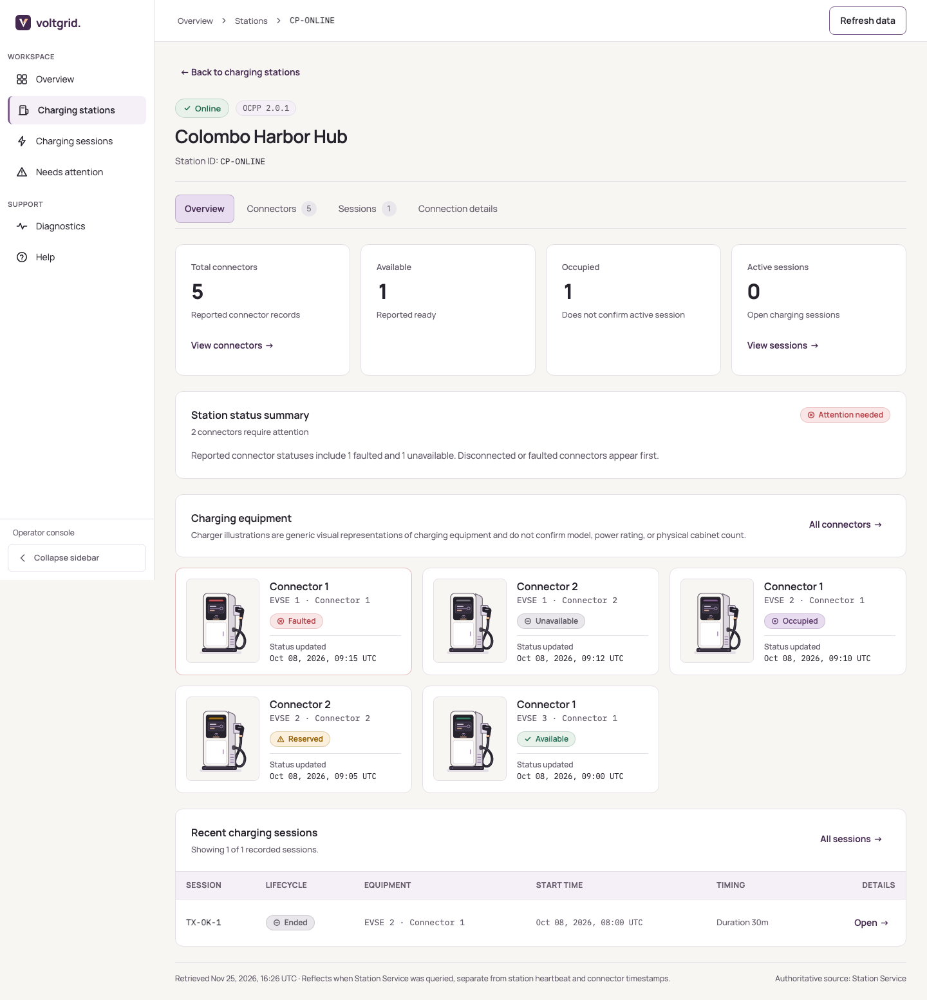
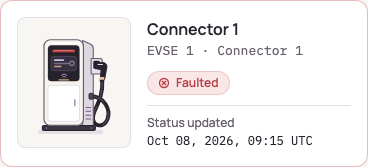
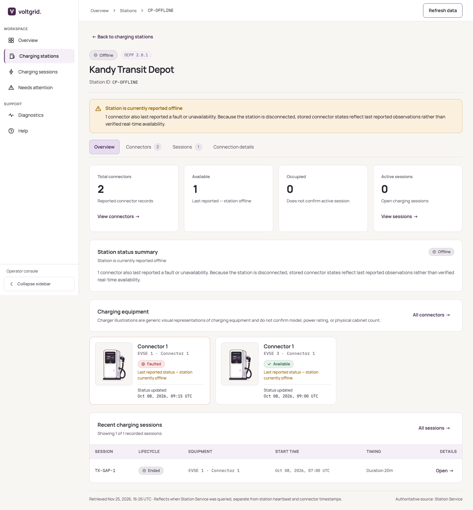

# VoltGrid Experience Redesign — Release Evidence Index (UI-110)

- **Development branch**: `redesign/operator-experience`
- **Target branch**: `main` (baseline merge-base `f4708fb558226d8dfc43bcb2893b39f33782bab4`)
- **Backend/Infrastructure preservation**: Zero modifications to `services/`, `compose*.yaml`, `infrastructure/`, or runtime backend dependencies.
- **Documentation Note (UI-109 Terminology Correction)**: An earlier UI-109 engineering note inaccurately described offline stations on `/attention` as Operations projection data. Verified code in `apps/operator-web/src/app/attention/page.tsx` and `apps/operator-web/src/lib/attention-model.ts` uses `getStationSnapshot()` from authoritative **Station Service** for offline stations and `networkTransactionPage(integrityStatus: INCOMPLETE)` for incomplete sessions.

## 1. Curated Visual Evidence (Mandatory Charger Illustration Review — Pending Owner Approval)

| Artifact | Purpose | Screenshot |
|---|---|---|
| Station Overview Desktop (`1440×900`) | KPI cards, status summary, sorted connector cards (`Faulted` first), recent sessions |  |
| Station Overview Mobile (`390×844`) | Single-column stacking, tabs, simple charger cards |  |
| Close-up Charger Card | Generic pedestal cabinet, dark fascia, semantic light bar, abstract screen, docked plug |  |
| All 5 Connector Statuses | `Faulted`, `Unavailable`, `Occupied`, `Reserved`, `Available` |  |
| Offline Station & Guidance | Offline warning banner and *"Last reported status — station currently offline"* labels |  |

## 2. Engineering Verification Matrix

- **Unit/component tests** (`pnpm --dir apps/operator-web test`): **168 passed**, 0 failed, 0 skipped.
- **Lint & TypeScript**: `pnpm lint` passed (0 errors); `pnpm exec tsc --noEmit` passed (0 errors).
- **Production build** (`pnpm --dir apps/operator-web build`): Webpack production build passed cleanly without build-time network downloads.
- **Fixture Playwright Chromium Suite** (`pnpm --dir apps/operator-web test:e2e`): All **35** Chromium tests passing (covering shell, overview, stations, station detail, registration, sessions, session detail/measurements/technical, attention, diagnostics, help, integrated 14-journey regression, and `@axe-core/playwright` WCAG 2.2 AA).
- **Automated Accessibility** (`pnpm --dir apps/operator-web test:a11y`): `@axe-core/playwright` 4.14.1 (`wcag2a`, `wcag2aa`, `wcag21a`, `wcag21aa`, `wcag22aa`), **0 violations** across 35+ rendered screens, dialogs, empty/clear states, and partial/unavailable error states, plus `320×568` overflow and `44×44px` control target assertions.
- **Cross-Browser & Responsive Matrix** (`pnpm --dir apps/operator-web test:e2e:cross-browser` across `320×568`, `390×844`, `430×932`, `768×1024`, `1024×768`, `1280×800`, `1440×900`, `1920×1080`):
  - **Chromium (`Desktop Chrome`)**: **18 / 18 passed**.
  - **WebKit (`Desktop Safari` engine)**: **18 / 18 passed**.
  - **Firefox (`firefox-1543`)**: **Blocked in local macOS agent environment** (`Could not find profile folder.` on `Nightly.app` launch); configured in `.github/workflows/operator-web-ci.yml` (`ubuntu-latest`) for CI execution.
  - **Real Desktop Browsers**: Google Chrome & Safari are present on macOS (`Firefox.app` and `Microsoft Edge.app` not installed); manual real-browser walkthroughs remain **Pending human execution** (Playwright WebKit is not presented as real Safari).
- **Isolated Real-Stack Compose Verification** (`voltgrid-ui110-test`, `pnpm test:e2e:live`): **1 / 1 passed (`8.3s`)** across full OCPP WebSocket -> Station Service -> Authorization gRPC -> transactional outbox -> Kafka -> Operations Service -> PostgreSQL projections -> Console UI, including `StatusNotification` `Faulted`, `Energy.Active.Import.Register` cumulative disclosure, `INCOMPLETE` session gap in `/attention`, `/diagnostics` lookup, `/help`, all 6 nav links, and WebSocket disconnect `OFFLINE` transition + cleanup (`down -v --remove-orphans`).

## 3. Production Build Performance Assessment (Lab Proxies Only)

- **Environment**: Apple M4 (10-core, 16 GB RAM), macOS 27.2.1 (`26B131`), Chromium `153.0.8010.12`, production `next start`, loopback deterministic fixture (no throttling; 3 cold runs per route across 9 routes including 50 stations, 1,000 meter samples, and 10,000 sequence span).
- **Assets**: Total `.next/static` across entire app = `1.2 MB`; CSS = `37 KB`; local TTF fonts = `manrope-variable.ttf` (`161 KB`) + `ibm-plex-mono-regular.ttf` (`132 KB`) with `font-display: swap`. WOFF2 conversion was evaluated and **not needed** given zero/negligible CLS and sub-150ms local font readiness.
- **Measured Lab Ranges**: TTFB `2.1–71.3 ms`, FCP `28–132 ms`, LCP proxy `32–356 ms`, max CLS `0.0000–0.0157`, API requests per route `0–3` (zero N+1), local interaction latency proxy `59.3 ms` (1k-sample stream switch) and `82.4 ms` (Help disclosure toggle).
- **Limitations**: No public traffic exists; **field Core Web Vitals (p75 LCP / INP / CLS) are N/A (unavailable)** and Lighthouse CI CLI is not installed (`lighthouse not installed`). Lab metrics are proxies, not field INP measurements.

## 4. Security, Data Correctness, Advisories, & Defect Register

- **Resolved UI-110 Defects**:
  1. `session-detail-measurements.tsx`: Replaced undefined `--vg-border-strong` SVG axis stroke with `--vg-border-control` (`--vg-font-mono` applied consistently) and added `overflow-x-auto` + `aria-live="polite"` selected-point readout.
  2. `diagnostics-records.tsx`: Added `overflow-x-auto` to tablet/desktop table container and normalized `<CardHeader>` `min-w-0 flex-1` wrapping across overview/stations/station-detail cards.
  3. **WCAG 2.5.3 `label-content-name-mismatch`**: Aligned `aria-label` prefixes with visible text across session rows (`Open session ...`), attention sequence links (`Sequence details for session ...`), `CopyValueButton` (`Copy station ID ...` / `Copy ID for session ...` / `Copy event ID ...`), sidebar collapse toggle text, and `SessionsDirectoryFilters` filter chips (`min-h-11`).
  4. **WCAG 1.3.1 `<dl>` validity**: Restructured `<dl>` children in `station-connection-section.tsx` so `<dt>` and `<dd>` sit directly inside `
` groups without intermediate wrappers or buttons outside `<dd>`.
  5. **WebKit modal focus trap**: Updated `MobileNav` `Tab` / `Shift+Tab` wrapping to advance deterministically across all links and buttons in `focusables` even when macOS WebKit skips `<a>` links on default `Tab`.
  6. `station-api.ts` & `session-detail-model.ts`: Failed `getStationPageData()` sections closed when unpathed GraphQL errors occur alongside empty arrays; passed explicit `""` fallback in `sanitizeSessionDetailReturnPath()`.
- **Malformed URLs (`/stations/%ZZ`, `/stations/CP-1/sessions/%ZZ`)**: Reproduced on Next.js 16.3.5 production server: App Router rejects un-decodable `%` escapes at framework URL parsing prior to app code with plain-text `HTTP 500 Internal Server Error` (`21 bytes`, zero stack trace/path leak; `/%ZZ` returns `404`; properly encoded `/stations/%25ZZ` decodes once to `%ZZ` and returns `404`). Classified as **P3 cosmetic framework limitation** (zero info disclosure/availability risk); deferred to future framework major upgrade without custom server wrapper.
- **Dependency Audit (`pnpm audit`)**: Baseline dependencies remain locked (`next@16.3.5`, `react@19.2.8`); `@axe-core/playwright@4.14.1` added strictly to `devDependencies`. Next.js runtime advisories (`next/og ImageResponse`, `next/image`, `use cache`, ISR, Edge runtime, dev MCP) are not exposed because those APIs are unused and dynamic routes use `force-dynamic` + `no-store`; Server Actions in `/stations/new` are restricted to loopback hosts + `OPERATOR_LOCAL_WRITES=true`. Build/lint-only dev advisories (`eslint-config-next` -> `zod`, `minimatch`; `source-map-js`) do not affect runtime.

## 5. Rollback Strategy

No commits modify `main`. Rolling back after merge uses standard non-destructive Git history revert (`git revert -m 1 <merge-commit-sha>`), or closing/reverting the branch while `main` remains intact at its pre-merge head (`c04d347` / `f4708fb`). No database migrations or backend rollbacks are involved.

## 6. Release Gate Status Matrix (G1–G8)

| Gate | Requirement | Status | Summary |
|---|---|---|---|
| **G1 Visual** | Approved tokens/Voltmark/Prototype V3 charger review | **Pending human validation** | Visual audit & 5 charger screenshots complete; owner sign-off pending. |
| **G2 Functional** | Unit/component/browser/live E2E, legacy compatibility | **Passed** | 168 unit tests, 35 Chromium E2E, and 1 real-stack `voltgrid-ui110-test` E2E passing. |
| **G3 Accessibility** | WCAG 2.2 AA automated + manual keyboard & AT | **Pending human validation** | `@axe-core/playwright` 0 violations; 320px/200%/44px checks pass; VoiceOver/NVDA manual walkthrough pending. |
| **G4 Responsive** | Chromium/Firefox/WebKit × 8 viewports | **Partially verified** | All 8 viewports pass in Chromium & WebKit (36/36); local Firefox binary blocked (`Could not find profile folder.`), configured for CI `ubuntu-latest`; manual Safari/Chrome/Edge checks pending/unavailable. |
| **G5 Performance** | Production lab evaluation, no field regression | **Partially verified** | Lab proxies well below targets (CLS <= 0.0157, LCP <= 356ms, zero N+1); field p75 Core Web Vitals N/A (no public traffic) & Lighthouse CI not installed. |
| **G6 Data & Security** | Authoritative boundaries, measurements, local write gate | **Passed** | Hardened partial error handling, validated routes, loopback mutation checks, advisory applicability audited. |
| **G7 User validation** | 10-participant SUS >= 80, >= 90% completion targets | **Pending human validation** | Reproducible study kit ready under `docs/usability-testing/`; 0 human sessions conducted yet. |
| **G8 Release readiness** | Docs, rollback, CI checks, PR review & owner approval | **Pending human validation** | Docs, evidence index, rollback plan, and CI workflow ready; GitHub Actions run & owner PR sign-off required before merge. |
