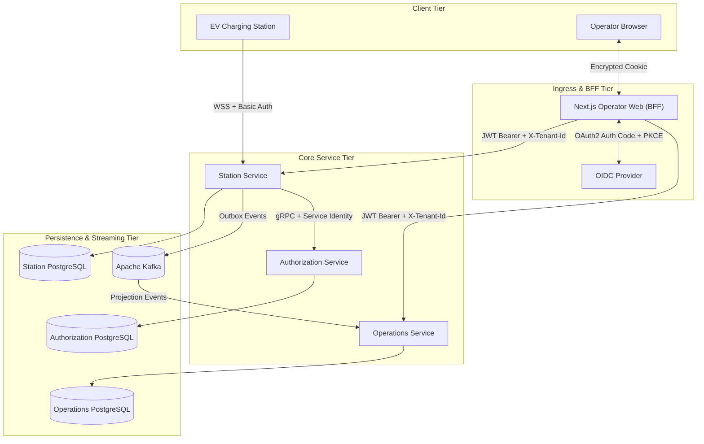
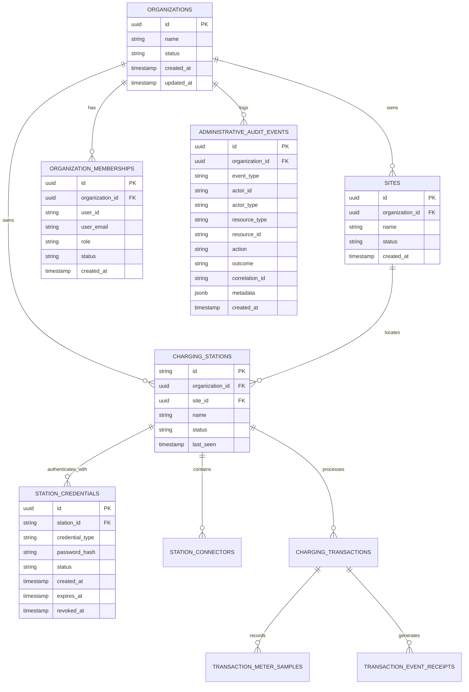

# VoltGrid Identity, Authentication, and Access Management Architecture

## 1. Executive Summary
This architecture specification establishes the multi-tenant commercial security foundation for VoltGrid under milestone **VG-202**.

The design encompasses:
1. **Human Identity & OIDC**: Federated identity via standards-compliant OIDC, token validation via Spring Security OAuth2 Resource Server, and Next.js Backend-For-Frontend (BFF) session security.
2. **Multi-Tenant Data Model**: Relational organization, site, and station ownership hierarchy with tenant-isolated database schemas and Flyway migrations.
3. **Resource-Level Authorization**: Organization-scoped Role-Based Access Control (RBAC) with fine-grained permissions and server-side default-deny policies.
4. **Charging Station Authentication**: OCPP 2.0.1 Security Profile 2 basic authentication with salted cryptographic hashes, credential provisioning, rotation, and revocation.
5. **Service Identity & Secret Management**: Authenticated inter-service gRPC communication and versioned HMAC key rotation for driver charging tokens.
6. **Administrative Audit Trail**: Append-only audit logging of security-critical actions with tenant-scoped queryability and automatic secret redaction.

---

## 2. Component Architecture

---

## 3. Data Model & Entity Relationships

### Entity Relationship Diagram

---

## 4. Role-Permission Matrix

| Permission | Description | PLATFORM_ADMIN | ORG_OWNER | ORG_ADMIN | OPERATOR | TECHNICIAN | SUPPORT | FINANCE |
| :--- | :--- | :---: | :---: | :---: | :---: | :---: | :---: | :---: |
| `org:read` | View organization details | ✓ | ✓ | ✓ | ✓ | ✓ | ✓ | ✓ |
| `org:manage` | Edit organization settings | ✓ | ✓ | - | - | - | - | - |
| `member:read` | View organization members | ✓ | ✓ | ✓ | - | - | - | - |
| `member:manage` | Invite, update, or revoke members | ✓ | ✓ | - | - | - | - | - |
| `site:read` | View sites | ✓ | ✓ | ✓ | ✓ | ✓ | ✓ | ✓ |
| `site:manage` | Create and modify sites | ✓ | ✓ | ✓ | - | - | - | - |
| `station:read` | View stations and connector status | ✓ | ✓ | ✓ | ✓ | ✓ | ✓ | ✓ |
| `station:register`| Register new charging stations | ✓ | ✓ | ✓ | - | - | - | - |
| `station:manage` | Update station configuration | ✓ | ✓ | ✓ | - | ✓ | - | - |
| `credential:provision` | Issue device credentials | ✓ | ✓ | ✓ | - | - | - | - |
| `credential:rotate` | Rotate station credentials | ✓ | ✓ | ✓ | - | - | - | - |
| `credential:revoke` | Revoke station credentials | ✓ | ✓ | ✓ | - | - | - | - |
| `session:read` | View charging sessions and receipts | ✓ | ✓ | ✓ | ✓ | - | ✓ | ✓ |
| `meter:read` | View detailed meter samples | ✓ | ✓ | ✓ | ✓ | ✓ | - | ✓ |
| `integrity:read` | Query transaction completeness | ✓ | ✓ | ✓ | ✓ | ✓ | - | ✓ |
| `audit:read` | View administrative audit logs | ✓ | ✓ | ✓ | - | - | - | - |

---

## 5. Security Invariants & Guarantees
1. **Server-Side Authorization**: Client-provided headers (`X-Tenant-Id`) are validated against the user's active database membership. A user cannot access resources in an organization they do not belong to.
2. **Device Password Hashing**: Station passwords are never stored in plaintext. They are hashed with PBKDF2/BCrypt with unique cryptographic salts.
3. **Fail-Closed gRPC & API Gates**: Unauthenticated requests to GraphQL mutations, queries, or gRPC methods are rejected by default.
4. **Append-Only Audit Trail**: Administrative audit logs can only be created; they cannot be updated or deleted through application APIs.
5. **Transparent HMAC Key Migration**: Charging tokens hashed with legacy HMAC keys remain operable and are transparently migrated upon valid presentation.
