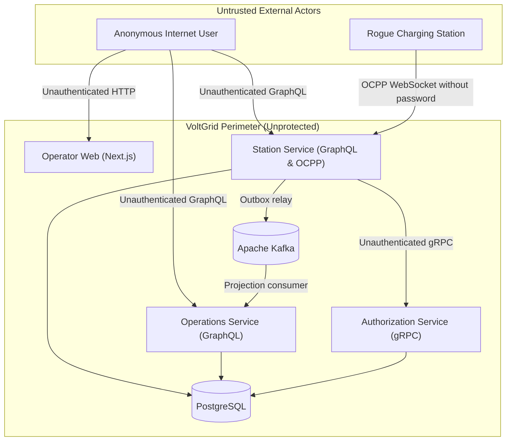

# VoltGrid STRIDE Threat Model & Trust Boundaries

## 1. Overview
This document establishes the threat model for VoltGrid following the **STRIDE** methodology (Spoofing, Tampering, Repudiation, Information Disclosure, Denial of Service, Elevation of Privilege) as part of milestone **VG-202**.

---

## 2. Trust Boundaries & Architecture Diagrams

### Current State (Pre-VG-202: Trusted Local Prototype)


### Proposed State (VG-202: Multi-Tenant Commercial Foundation)
```mermaid
flowchart TD
    subgraph ExternalActors ["External Actors & Identities"]
        Operator["Authenticated Operator"]
        IdP["OIDC Provider (Keycloak / Cognito)"]
        Charger["Charging Station (OCPP Profile 2)"]
        Attacker["Attacker / Rogue Station"]
    end

    subgraph TrustBoundaryBFF ["Trust Boundary: Frontend & BFF"]
        NextBFF["Next.js BFF (Server Session)"]
        CookieStorage["HttpOnly Encrypted Session Cookie"]
    end

    subgraph TrustBoundaryBackend ["Trust Boundary: Backend Resource Servers"]
        StationAPI["Station Service (OAuth2 Resource Server)"]
        OpsAPI["Operations Service (OAuth2 Resource Server)"]
        AuthGRPC["Authorization Service (gRPC Interceptor)"]
        AuditLog["Administrative Audit Trail"]
    end

    subgraph DataStorage ["Data & Event Persistence"]
        StationDB[(Station DB: Multi-Tenant Schema)]
        OpsDB[(Operations DB: Tenant Projections)]
        AuthDB[(Authorization DB: Versioned HMAC)]
        KafkaCluster[(Apache Kafka)]
    end

    Operator <-->|OIDC Auth Code + PKCE| IdP
    Operator <-->|Session Cookie (HttpOnly, Secure)| NextBFF
    NextBFF -->|JWT Bearer + X-Tenant-Id| StationAPI
    NextBFF -->|JWT Bearer + X-Tenant-Id| OpsAPI
    Charger -->|WSS + Basic Auth with Hashed Credential| StationAPI
    Attacker -.->|Rejected: 401 Unauthorized| StationAPI

    StationAPI -->|gRPC + Service Identity Token| AuthGRPC
    StationAPI -->|Transactional Append| AuditLog
    StationAPI -->|Scoped SQL by organization_id| StationDB
    OpsAPI -->|Scoped SQL by organization_id| OpsDB
    AuthGRPC -->|Versioned HMAC Lookup| AuthDB
    StationAPI -->|Outbox Relay| KafkaCluster
    KafkaCluster -->|Scoped Ingestion| OpsDB
```

---

## 3. STRIDE Threat Analysis

| Threat Category | Asset / Interaction | Threat Description | Pre-VG-202 Vulnerability | VG-202 Mitigation Control |
| :--- | :--- | :--- | :--- | :--- |
| **Spoofing** | Operator Identity | Attacker impersonates an operator or tenant administrator. | Anonymous access to all GraphQL queries and mutations. | Mandatory OIDC authentication; JWT signature, issuer, and audience validation via Spring Security OAuth2. |
| **Spoofing** | Charging Station | Rogue charger connects using a legitimate charger's station ID. | WebSocket accepted based on URL path only; password was unchecked. | OCPP Security Profile 2: HTTP Basic Auth with salted PBKDF2/BCrypt hashes stored in `station_credentials`. |
| **Spoofing** | Inter-Service gRPC | Unauthorized internal process queries Authorization Service. | Plaintext unauthenticated gRPC on port 9090. | Service-to-service authentication via gRPC metadata interceptor. |
| **Tampering** | Station Topology & Status | Attacker alters station names, coordinates, or connector status. | Anyone could call `registerStation` or inject WebSocket status. | Fine-grained RBAC (`station:register`, `station:manage`) scoped by active organization membership. |
| **Tampering** | Multi-Tenant Data | Operator from Org A alters or overwrites Org B stations. | No tenant boundaries existed in database schemas. | Relational `organization_id` foreign keys, `TenantContext` enforcement, and server-side authorization. |
| **Tampering** | RFID Charging Tokens | Attacker modifies stored token fingerprints to match stolen cards. | Single static development HMAC key; no key versioning. | Versioned HMAC key management with automatic migration, rejecting weak keys in production. |
| **Repudiation** | Administrative Actions | Administrator denies provisioning, rotating, or revoking credentials. | Zero administrative audit logs existed. | Append-only `administrative_audit_events` capturing actor, action, timestamp, resource, and outcome. |
| **Information Disclosure** | Cross-Tenant Leakage | Operator in Org A lists stations, sessions, or meter samples of Org B. | All GraphQL queries returned global data across the platform. | Server-side default-deny authorization; all queries filter strictly by user's verified `organization_id`. |
| **Information Disclosure** | Token & Credential Theft | Attacker extracts bearer tokens or station passwords from storage or logs. | Credentials could leak into browser storage or logs. | Tokens kept in server-side HttpOnly cookies; station passwords hashed; secrets redacted from audit/logs. |
| **Denial of Service** | WebSocket Reconnect Race | Rapid reconnect loop exhausts server memory or drops valid stations. | Session teardown races could mark active stations offline. | In-memory session tracking (`activeStationSessions`) with disconnect ownership verification. |
| **Elevation of Privilege** | Horizontal Escalation | Operator in Org A assigns themselves roles or accesses Org B resources. | No role or organization validation on requests. | Organization-scoped RBAC; operations verify explicit membership in requested tenant context. |
| **Elevation of Privilege** | Vertical Escalation | Operator assigns themselves `ORG_OWNER` or rotates device credentials. | Coarse-grained or missing role permissions. | Fine-grained permissions (`member:manage`, `credential:rotate`); validation prevents self-escalation. |

---

## 4. Abuse Cases & Detailed Attack Scenarios

### Abuse Case 1: Station Impersonation (SEC-001 / SEC-03)
- **Attack Vector**: Attacker configures a hardware simulator with a known station ID (e.g., `STA-ABB-001`) and initiates a WebSocket connection to `/ocpp/STA-ABB-001`.
- **Expected Defense**: Handshake interceptor extracts `Authorization: Basic ...`. If credentials are missing, malformed, or do not match the stored salted hash in `station_credentials`, the connection is immediately terminated with `401 Unauthorized` before establishing a WebSocket session.

### Abuse Case 2: Cross-Tenant Resource Access (CORE-01 / SEC-02)
- **Attack Vector**: Authenticated operator from "Ceylon EV Networks" crafts a GraphQL query requesting `station(id: "STA-FAST-099")` owned by "Lanka Charging Ltd", or passes `X-Tenant-Id: org_lanka`.
- **Expected Defense**: Server extracts tenant context from the user's verified session. If the user does not possess an active membership in the target organization, or if the station does not belong to the user's authorized organization, the resolver returns `ACCESS_DENIED` (or `null` / empty dataset), preventing cross-tenant leakage.

### Abuse Case 3: Replay of Revoked Device Credentials
- **Attack Vector**: An untrusted field technician steals a station's basic auth password. An administrator revokes the credential via the operator console. The attacker attempts to connect with the revoked password.
- **Expected Defense**: The credential record status in `station_credentials` is `REVOKED`. The handshake interceptor queries active credentials only, rejecting the revoked credential with `401 Unauthorized`. Any existing connection is severed.

### Abuse Case 4: Insecure Token Fingerprint Default Key Compromise (SEC-003)
- **Attack Vector**: Attacker accesses the repository or inspects open-source code, discovers the hardcoded development key `voltgrid-local-development-hmac-key-change-me`, and generates candidate fingerprints for driver RFID cards.
- **Expected Defense**: In production configuration, `TokenFingerprintService` validates the active HMAC key at startup. If the key matches default development strings or is shorter than 32 bytes, application startup terminates immediately (`fail-fast`).
